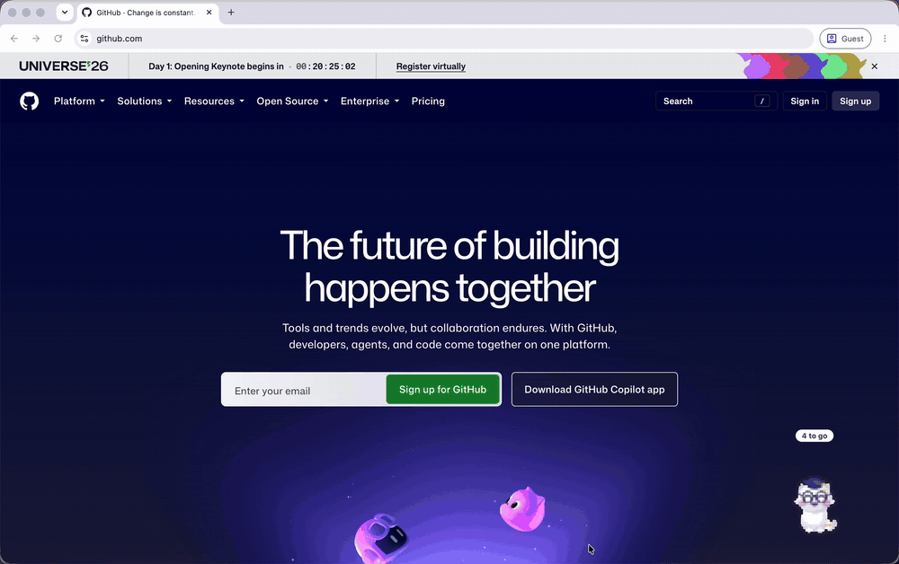

# Pocket Pet

A little pet that lives on your desktop (Mac or Windows) and keeps track of your micro habits.



## Want to use it? Download the app

Go to the **Releases** section of this page (on the right) and download the file for your computer:

- **Mac with an Apple chip** (M1, M2, M3…): `Pocket-Pet-mac-apple-chip.zip`
- **Older Intel Mac:** `Pocket-Pet-mac-intel.zip`
- **Windows:** `Pocket-Pet-windows.zip`

The app isn't signed by Apple or Microsoft, so the first time you open it your computer might warn you:

- **Mac:** unzip it and drag **Pocket Pet** into Applications. Open it; when macOS says it can't be verified, click **Done**, then go to **System Settings → Privacy & Security**, scroll down and click **Open Anyway**.
- **Windows:** unzip it (right-click → **Extract All**), keep the folder somewhere like Documents, and double-click **Pocket Pet.exe**. If you see "Windows protected your PC", click **More info → Run anyway**.

After that it opens normally and starts by itself when you log in.

The steps below are for running it from using code instead.

## First-time setup on a Mac (about 5 minutes)

1. **Install Node.js.** Go to https://nodejs.org, download the **LTS** version for macOS, and run the installer.
2. **Unzip** `pocket-pet.zip` somewhere you'll keep it, e.g. your `Documents` folder.
3. **Open Terminal** (press Cmd + Space, type `Terminal`, press Enter).
4. Type `cd ` (with a space after it), drag the `pocket-pet` folder into the Terminal window, then press Enter.
5. Run this once to download the parts the app needs:
   ```
   npm install
   ```
6. Start your pet:
   ```
   npm start
   ```

The blob appears in the bottom-right corner of your screen. Leave the Terminal window open while it runs (you can minimise it).

## First-time setup on Windows (about 5 minutes)

1. **Install Node.js.** Go to https://nodejs.org, download the **LTS** version for Windows, and run the installer (the default options are fine).
2. **Unzip** `pocket-pet.zip` (right-click it, **Extract All**) somewhere you'll keep it, e.g. your `Documents` folder.
3. **Open Command Prompt:** press the Windows key, type `cmd`, press Enter. (Use Command Prompt rather than PowerShell; PowerShell sometimes blocks `npm` with "running scripts is disabled".)
4. Type `cd ` (with a space after it), drag the `pocket-pet` folder into the window, then press Enter.
5. Run `npm install` once, then `npm start`.

The blob appears in the bottom-right corner, just above the taskbar. Everything works the same as on a Mac, with these differences:

| On a Mac | On Windows |
|---|---|
| Option + Command + P naps or wakes the pet | **Ctrl + Alt + P** |
| Blob icon in the menu bar | Pink blob icon by the clock (it may be hidden under the **^** arrow; drag it onto the taskbar to keep it visible) |
| While napping, a sleeping blob sits in the Dock | While napping, a sleeping blob sits on the **taskbar**: click it to wake the pet |
| Data in `~/Library/Application Support/Pocket Pet/` | Data in `%APPDATA%\Pocket Pet\` (paste that into File Explorer's address bar) |

**Make it start with Windows (optional):** in Command Prompt in the `pocket-pet` folder, run `npm run package`. Open `dist\Pocket Pet-win32-x64` and double-click **Pocket Pet.exe**. Windows may show "Windows protected your PC" because the app isn't signed: click **More info**, then **Run anyway**. It adds itself to your start-up apps (turn that off in **Settings → Apps → Startup**). Keep the whole `Pocket Pet-win32-x64` folder somewhere permanent, e.g. Documents, since the .exe needs the files beside it.

## Using it

| Do this | What happens |
|---|---|
| Click the pet | Opens or closes today's habit list |
| Double-click the pet | Pokes it (it giggles and makes hearts) |
| Wiggle the mouse back and forth over it | Strokes it (makes hearts) |
| Drag the pet | Moves it anywhere; it remembers the spot |
| Right-click the pet | Nap, show habits, say hi, or quit |
| Click a circle | Ticks a habit off (click again to undo) |
| Hover a habit, click **Edit** | Rename it, change category or days, or delete it |
| **+ Add a habit** | Adds a new one |
| Esc | Closes the editor or the list |
| **Nap** (right-click menu) | Hides the pet; a sleeping blob appears in your Dock |
| **Option + Command + P** | Naps or wakes the pet from anywhere |
| Click the sleeping blob in the Dock | Wakes the pet up (right-click it for **Wake up** too) |
| Menu bar blob icon | Same menu as right-clicking the pet, if your menu bar is showing |
| Menu, **Say hi** | Shows a fresh greeting and motivation line |
| Menu, **Change your name…** | Changes the name your pet calls you (also under **It calls you** in the pet's details) |
| Menu, **Add starter habits** | Adds any starter-pack habits you don't already have |
| **Graduate** button (habit list, once it's an adult) | Holds the graduation ceremony |
| **Graduated** button (habit list) or the menu | Shows every pet you've raised hanging out in the cafe, having a picnic, or chilling in space |
| **History** button (habit list) or menu, **History** | Calendar, streaks and a journal for every pet |

- At the top of the habit list your pet shows as one tidy row (picture, stage, species and name). Tap it to open its details: stage and XP, mood and look, the graduate button, name, species and colour. Tap again to fold it away; it remembers which way you left it.
- The badge above the pet shows how many habits are left today.
- Every so often your pet does a few little hops left or right, then settles. It always stays close to where you put it, and keeps still while your mouse is over it, while the habit list is open, while it's talking or napping.
- Habits set to other days appear under **Not today**.
- A new day starts at **4am**, so ticking things off after midnight still counts for the day.
- The graduated cafe theme follows Mac's light or dark mode.

### How it grows

- Your pet starts as an **egg**, then becomes a **baby** (small, big sparkly eyes, one curl), a **teen** (taller, little feet, two-strand tuft) and an **adult** (arms, one waving, and a crown tuft).
- **Name it:** in the habit list, tap **Name me** (or **Rename**). It shows as "Baby Yumi", "Teen Yumi" and so on, in the list and when you hover over the pet.
- **Colour:** new eggs hatch in **Natural**, the animal's real-life colouring (the rainbow dot). You can switch to pink, peach, mint, sky, lavender, lemon, cloud or cocoa from the dots in the habit list any time while it's growing up. Every colour recolours the whole creature in matching shades: a mint phoenix has mint flames. Pandas keep their white fur, and only their black patches take the colour.
- Every habit you tick earns XP. A whole day is worth 100 XP however many habits you have, including a small bonus for finishing everything.
- Rough timing with steady habits: hatches after one good day, teen after about 5 days, adult after about 2 weeks.
- Each tick drops a treat into its mouth: an apple for Study, a banana for Fitness, tea for Mind, water for Health.
- **Moods:** happy once you've ticked something today; sleepy after a quiet day; droopy after three. One tick perks it right up, and it never loses progress.
- The habit list shows its stage, mood and how much XP until the next stage.

### Style

- Pets are drawn as **pixel art** by default: chunky pixels, a dark pixel outline and a small colour palette, like a retro handheld game. They bounce, blink, eat and sparkle.
- If you prefer the smooth look, open the pet's details in the habit list and switch **Style** from **Pixel** to **Soft**. It changes every pet everywhere (desktop, visitors, hangout, History) straight away, and you can switch back any time.

### Species

- **Choose your creature** with **Choose** (or **Change**) on the Species row of the habit list: a grid of all 16, drawn in your pet's colour. **Randomise** switches to a random different one. You can change it any time until it graduates.
- If you don't choose, a new egg is a **Mystery egg** and hatches into a surprise, one of 16 creatures: **blob, bunny, cat, frog, capybara, red panda, quokka, sea otter, panda, raccoon, ferret, bear, lamb**, or one of the mythical ones: **dragon, phoenix or pegasus**. It tells you what it is when it hatches.
- Each species has its own body and grows up visibly:
  - **Cat:** sits upright with a fluffy chest, darker ears, muzzle and tail; the tail gets longer as it grows.
  - **Frog:** chubby with huge eyes on top; the eyes get bigger as it grows.
  - **Bunny:** big head and huge eyes; one ear starts to flop as a teen.
  - **Dragon:** horn nubs as a baby, then wings and longer horns, then big wings and a spiky spade tail.
  - **Capybara:** a chunky loaf with a big snout; adults balance an orange on their head.
  - **Red panda:** white eyebrows, cheeks and muzzle, dark legs and a big ringed tail.
  - **Quokka:** round pink-lined ears, a dark button nose and a big smile.
  - **Sea otter:** a pale face, tiny ears, whiskers, and a shell to hold once it's a teen.
  - **Panda:** black ears, arms, legs and eye patches.
  - **Raccoon:** a dark mask, pointed ears and a ringed tail.
  - **Ferret:** a cream face and chest, a soft mask, dark legs and a long dark tail.
  - **Bear:** round ears, a pale muzzle and a cosy belly.
  - **Lamb:** a fluffy wool cloud, a peach face and floppy ears.
  - **Phoenix:** a golden fire bird with a flame crest, fiery wings and a sweeping flame tail.
  - **Pegasus:** a white pony with a pastel mane, feathered wings and lilac hooves.
  - Winged creatures' wings grow at each stage, and the phoenix opens its beak to eat and grin.
- Every species works with every colour and outfit.
- Pets you already have keep their species.

### Fun mysteries: Shinies ★

- Every egg has a **1 in 4** chance of hatching **shiny**, whether you picked the species or randomised it, similar to Pokemon! The roll happens once, at the moment it hatches.
- A shiny is solid gold, with a soft shimmer that sweeps across it and little stars twinkling around it. When it hatches you get a golden burst and **"Congratulations! You got a Shiny …!"**
- Its name gets **"Shiny"** in front of it forever ("Baby Shiny Yumi"), including in the hangout, on the desktop as a visitor, in History and at graduation.
- Shinies stay gold, so the colour dots are hidden for them. You can still choose its species before it hatches.

### Its look

- Whichever category you've ticked most in the **last 7 days** decides its outfit:
  - **Study → Nerdy:** round glasses and a graduation cap
  - **Fitness → Sporty:** a sweatband and a jersey
  - **Mind → Zen:** a soft halo and a leaf
  - **Health → Glowy:** a sleep mask on its forehead and twinkly sparkles
- Your second-most-ticked category adds a small badge on its side.
- The look is rechecked **every 2 days**, so one off day won't flip it. When the main look changes, it sparkles and tells you.
- Eggs don't wear outfits; the look appears once it hatches. The habit list shows the current look and when it's next checked.

### Graduation and the hangout

- When your pet becomes an adult, it says it's ready. Graduate whenever you like: press **Graduate** in the habit list (or use the right-click menu).
- The ceremony shows how long you raised it, how many habits you ticked and its favourite category. Confirm its name, then **Send to …** (wherever your graduates hang out).
- Its **name, look, badge and colour are frozen** forever. A new egg arrives in its natural colouring. Habits you'd already ticked that day don't count toward the new egg.
- The **café** gives every graduate its own table and a drink that matches its look: coffee (Nerdy), smoothie (Sporty), tea (Zen), sparkling water (Glowy) or hot chocolate (no look). Click one to see its usual order, when it hatched and graduated, and what it was raised on. In dark mode it's the café in the evening. Regulars mingle too: every few seconds one walks over to a friend's table for a quick chat, then heads back to its own seat.
- **Pick the hangout** with the **Café | Picnic | Space** buttons at the top of its window. It remembers your choice, and messages follow it:
  - **Café:** tables and drinks (coffee, smoothie, tea, sparkling water, hot chocolate).
  - **Picnic garden:** gingham blankets under a big tree and bunting, with a book, frisbee, pot of tea, watermelon or cupcake. Fireflies come out in dark mode.
  - **Space station:** little floating planets among the stars, with a telescope, rocket, pocket star, space juice or comet.
- **Invite to desktop:** up to 2 graduates can come and sit beside your current growing pet. Now and then one shuffles over to nuzzle your pet (with hearts), or says something and your pet answers. Click a visitor to say hi; its table shows a "Back soon" card. Use **Call back to the café** to return it.

### History

- **Calendar:** each day is shaded by how much of that day's list you did; a star means everything was done. Flip back through past months. Above it: total habits ticked, perfect days, and days in a row with at least one tick.
- **Streaks:** each habit's current and best streak, plus its last 14 days. Days a habit isn't scheduled never break its streak, and today only counts once you tick it.
- **Pets:** a journal card for your current pet and every café regular, with the dates it hatched, became a teen, became an adult and graduated, its look, and what it was raised on.
- It updates live while it's open.

### Your name

The first time it starts, the habit list opens and asks what your pet should call you. It uses that in greetings ("Good morning, Sam!"). Change it any time from the right-click menu (**Change your name…**) or in the pet's details.

### When it talks

- **Greeting:** when the app starts, and when you open your laptop or unlock your screen after at least an hour away, it says good morning, afternoon or evening with a motivation line.
- **Nudges:** once around midday (12:30 to 5pm) and once in the evening (7pm to 11:30pm), only if habits are left. It stays quiet while you have the habit list open, while it's napping, and for 10 minutes after a greeting.
- Bubbles fade on their own and never take focus from what you're typing. Click the pet to dismiss one.
- **Add your own motivation lines** in `src/lines.js`, one per line inside quotes, then restart with `npm start`.

### Starter pack

New users start with ten tiny habits for body and mind. Delete any you don't want (**Edit → Delete**), or bring missing ones back with **Add starter habits** in the right-click menu.

- **Health:** drink a glass of water · get 2 minutes of daylight outside · phone away 30 min before bed
- **Mind:** 5 slow breaths with a long exhale · write down one good thing · message someone you care about (Tue, Fri)
- **Fitness:** move for 2 minutes · 1-minute stretch
- **Study:** read one page · practise a new skill for 5 min (Mon, Wed, Fri)

## Make it a real app that starts with your Mac (optional, Mac)

```
npm run package
```

This creates `dist/Pocket Pet-darwin-arm64/Pocket Pet.app` (or `-x64` on older Intel Macs).
Drag `Pocket Pet.app` into your **Applications** folder.

The first time you open it, macOS will warn that it's from an unidentified developer, because it isn't signed. Right-click the app, choose **Open**, then click **Open** again. After that, it opens normally and adds itself to your login items so it starts whenever you log in. You can turn that off in **System Settings → General → Login Items**.

## If you ever lose the pet

Press Ctrl + C in its Terminal (or Command Prompt) window, then run `npm start` again. It comes back where you left it. You can also press Option + Command + P (Ctrl + Alt + P on Windows).

## Where your data lives

Everything is saved on your Mac only, in:

```
~/Library/Application Support/Pocket Pet/data.json
```

If that file ever gets damaged, the app keeps the old copy next to it (named `data.damaged-…json`) and starts fresh.

## For developers

- Run the automatic checks with `npm test`.
- **Try things out:** start with `npm run try` instead of `npm start` and the right-click menu gets a **Try things out** item. It previews any stage, mood, look, species, colour or shiny, feeds treats, and plays every animation, the graduation ceremony and an example hangout. Nothing is saved; choose **Back to my real pet** when you're done. Regular users never see it, so growing up stays a surprise.
- **Making a release:** on GitHub, go to **Releases → Draft a new release**, create a tag like `v1.0.0`, and click **Publish release**. GitHub then builds the Mac and Windows apps (about 5–10 minutes, see the **Actions** tab) and attaches them to the release. The recipe is in `.github/workflows/build-apps.yml`.

Hope you enjoy growing with your pet!!
